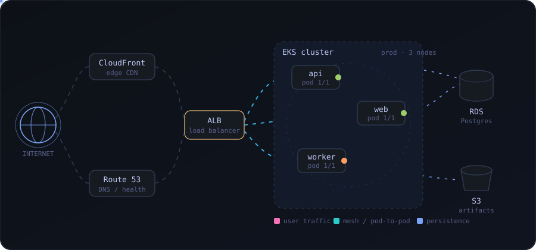
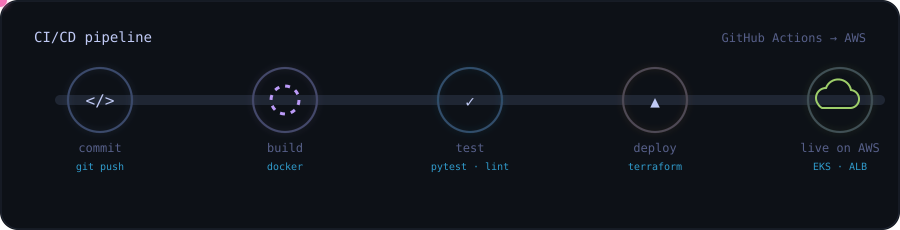
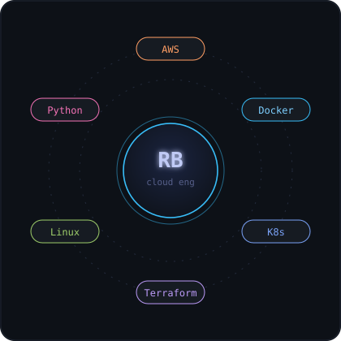

 

<!-- ══════════════ ANIMATED TERMINAL BOOT (custom SMIL asset) ══════════════ -->

 

<!-- ══════════════ LIVE ARCHITECTURE MAP ══════════════ -->

<!-- ══════════════ SKILL VISUALS ══════════════ -->

<table align="center"><tr>
<td align="center">

</td>
<td align="center">

</td>
</tr></table>

**☁️ Cloud & Infra** &nbsp; **🧑‍💻 Languages** &nbsp; **🛠️ Tooling**

 

 

 

<table align="center"><tr>
<td></td>
<td></td>
<td></td>
<td></td>
</tr></table>

<!-- ══════════════ TROPHIES + LIVE STATS ══════════════ -->

<table align="center"><tr>
<td align="center">

</td>
<td align="center">

</td>
</tr><tr>
<td align="center">

</td>
<td align="center">

</td>
</tr></table>

<!-- ══════════════ SNAKE (needs .github/workflows/snake.yml) ══════════════ -->

<picture>
  <source media="(prefers-color-scheme: dark)" srcset="https://raw.githubusercontent.com/rajbaibhav1910/rajbaibhav1910/output/github-contribution-grid-snake-dark.svg" />
  <source media="(prefers-color-scheme: light)" srcset="https://raw.githubusercontent.com/rajbaibhav1910/rajbaibhav1910/output/github-contribution-grid-snake.svg" />
  
</picture>

<!-- ══════════════ PINNED PROJECTS ══════════════ -->

<table align="center"><tr>
<td align="center">

</td>
<td align="center">

</td>
</tr><tr>
<td align="center">

</td>
<td align="center">

</td>
</tr></table>

<!-- Swap any pin for Atlas-AI-Assistant once that repo is public: repo=Atlas-AI-Assistant -->

<!-- ══════════════ CONNECT ══════════════ -->

  

 

